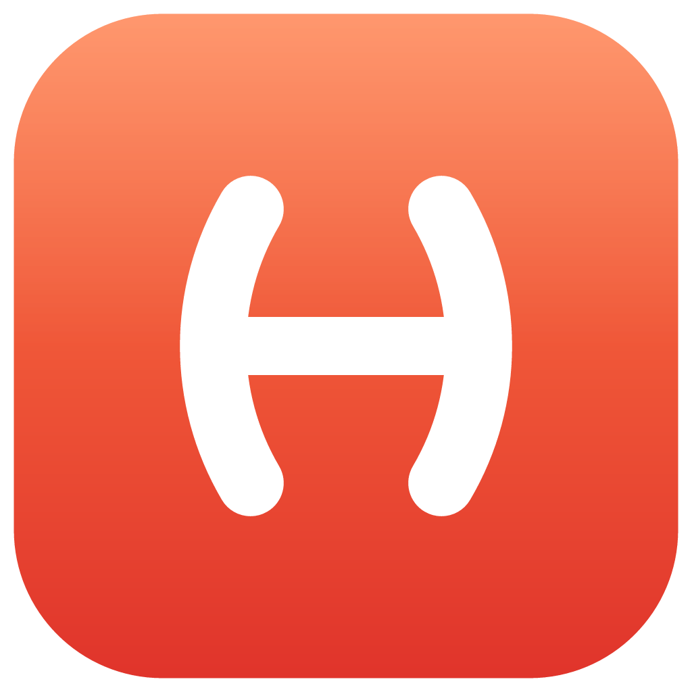

    
    <h1>Hark</h1>
    

        A private, fast, and honest web browser.
    

Hark is a Chromium-based browser, forked from
[Helium](https://github.com/imputnet/helium). This repo holds the
platform-independent part: patches, branding, translations, and build
utilities. Internal pages live at `hark://` (for example `hark://settings`).

## Hark repos
- [hark](https://github.com/masonxxyz/hark): core patches, resources and
  utilities (this repo).
- [hark-macos](https://github.com/masonxxyz/hark-macos): macOS packaging and
  the development environment. Start here to build.
- [hark-onboarding](https://github.com/masonxxyz/hark-onboarding): the
  first-run setup page at `hark://setup`.

## Infrastructure
Hark doesn't run its own servers yet, so some features still use Helium's
public infrastructure. These endpoints are intentionally left pointing
upstream:

| What | Endpoint | Used for |
| --- | --- | --- |
| Services | `services.helium.imput.net` | extension proxy, !bangs, filter lists, spellcheck |
| Web push | `push.helium.computer` | push notifications |
| uBlock Origin | [imputnet/uBlock](https://github.com/imputnet/uBlock) | bundled ad blocker |
| Non-free assets | [imputnet/helium-nonfree-assets](https://github.com/imputnet/helium-nonfree-assets) | search engine and browser icons |
| Chromium sources | [imputnet/chromium-tarballs](https://github.com/imputnet/chromium-tarballs) | prepared Chromium archives |

To move off them, self-host [helium-services](https://github.com/imputnet/helium-services)
and change the default origin in `patches/hark/core/services-prefs.patch`.
Users can also set their own origin in `hark://settings/privacy/services`.

Browser updates (`updates.hark.invalid`) and crash reports
(`crash.hark.invalid`) point at reserved `.invalid` hosts, so they're disabled
until Hark has its own update feed and crash server.

## Branding
Every logo and icon is generated from one geometry file:
[`resources/branding/source/hark_logo.py`](resources/branding/source/hark_logo.py).
To regenerate all assets (Chromium icons, wordmarks, macOS icon sources),
run `resources/branding/source/make_assets.py`.

Upstream Helium changes can be brought in by merging `imputnet/helium` and
re-running `devutils/rebrand.py` from the hark-macos repo.

## Development
[> See development docs in hark-macos](https://github.com/masonxxyz/hark-macos/blob/main/docs/building.md#development-build-and-environment)

## Credits

### Helium
Hark is a fork of [Helium](https://github.com/imputnet/helium) by
[imput](https://imput.net). Nearly everything that makes Hark what it is
comes from their work.

### The Chromium project
[The Chromium Project](https://www.chromium.org/) is at the core of Hark,
making it possible in the first place.

### ungoogled-chromium
Helium originally branched off
[ungoogled-chromium](https://github.com/ungoogled-software/ungoogled-chromium).

### Other Chromium projects
Hark includes some patches from other open source Chromium projects:

- [Inox patchset](https://github.com/gcarq/inox-patchset)
- [Debian](https://tracker.debian.org/pkg/chromium-browser)
- [Bromite](https://github.com/bromite/bromite)
- [Iridium Browser](https://iridiumbrowser.de/)
- [Brave](https://github.com/brave/brave-core)

All patches are sorted by vendor in the [patches](patches/) directory of this repo.

## License
All code, patches, modified portions of imported code or patches, and
any other content that is unique to Hark or Helium and not imported from other
repositories is licensed under GPL-3.0. See [LICENSE](LICENSE).

Any content imported from other projects retains its original license (for
example, any original unmodified code imported from ungoogled-chromium remains
licensed under their [BSD 3-Clause license](LICENSE.ungoogled_chromium)).
